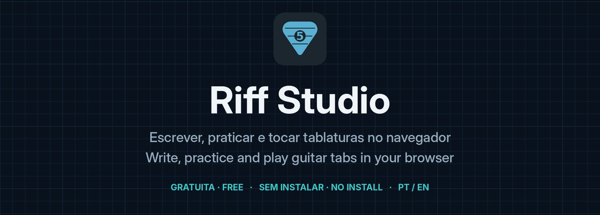
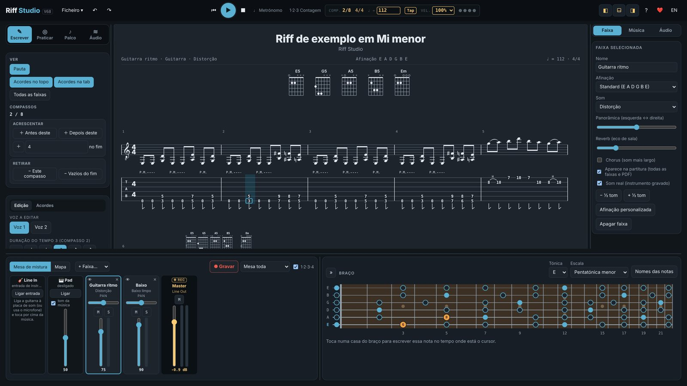
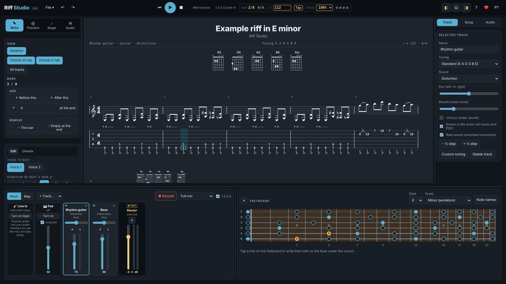
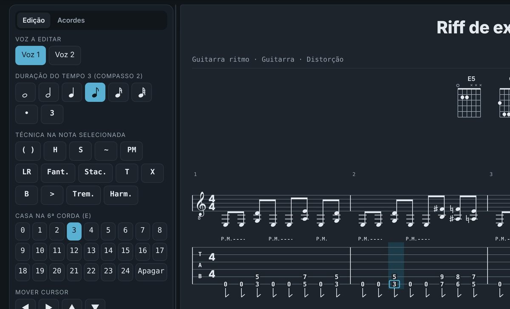
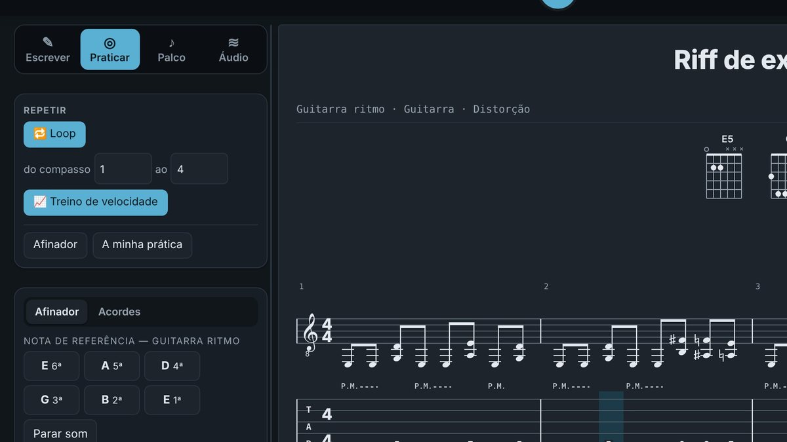
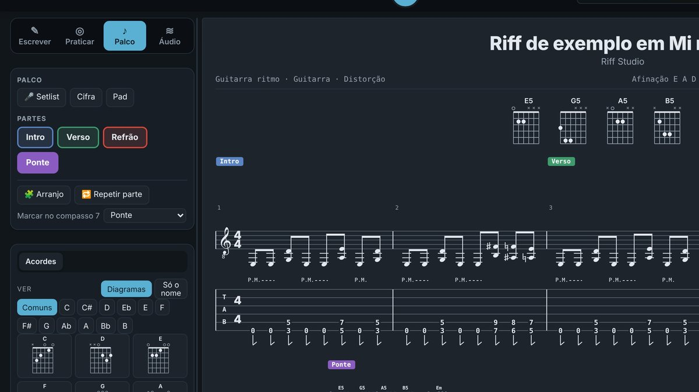
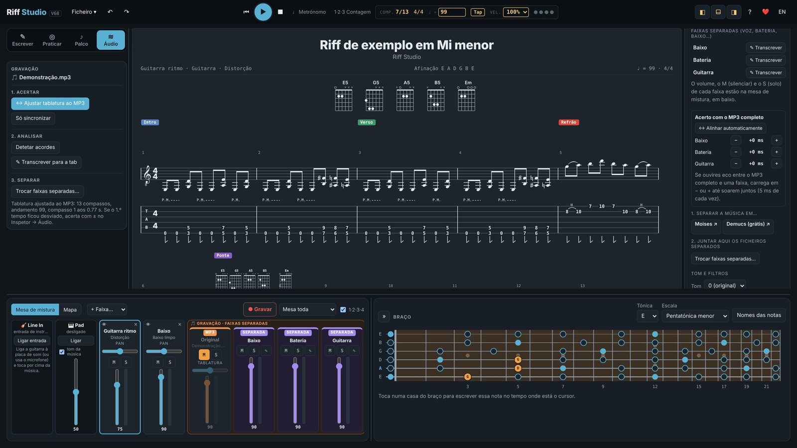
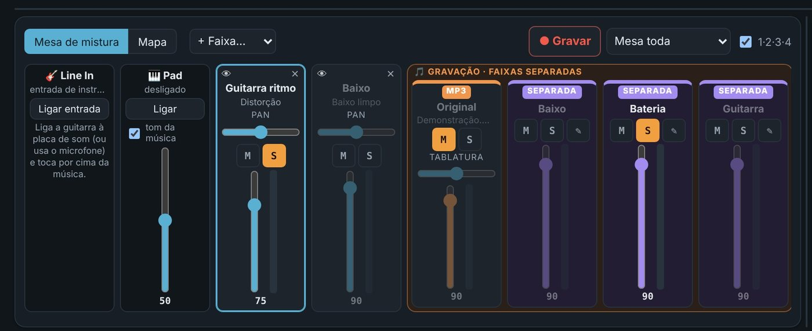
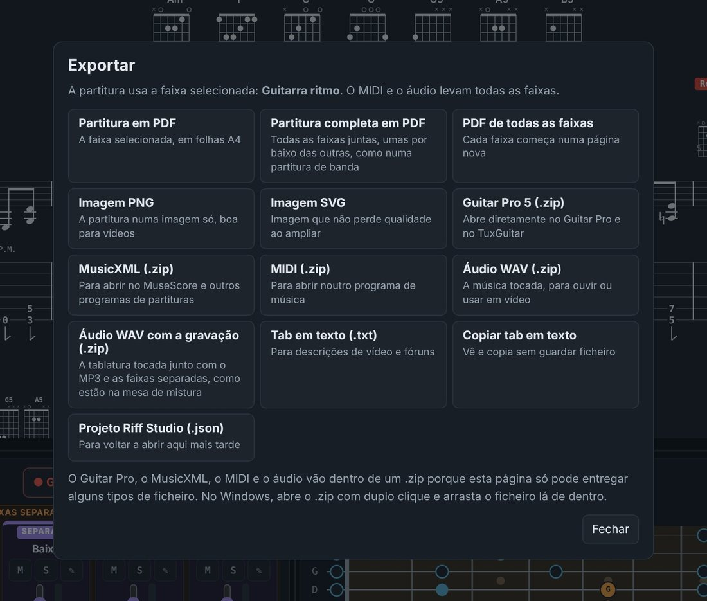

  

  <a href="https://josepedrorocha-star.github.io/riff-studio/"><b>▶ Abrir a app · Open the app</b></a>
  &nbsp;·&nbsp;
  <a href="https://www.youtube.com/@BlueprintRiff">YouTube — Blueprint &amp; Riff</a>
  &nbsp;·&nbsp;
  <a href="#apoiar">❤️ Apoiar · Support</a>

Versão / Version v1.0 · por / by <b>jprocha-pt</b>

🇵🇹 A **Riff Studio** é uma app gratuita para escrever, praticar e tocar tablaturas de guitarra. Corre toda no navegador — não é preciso instalar nada.

🇬🇧 **Riff Studio** is a free app to write, practice and play guitar tabs. It runs entirely in your browser — nothing to install.

  
  

Em português e em inglês · In Portuguese and English

---

## ✎ Escrever · Write

🇵🇹 Clica na tablatura e escreve o número da casa. Pauta clássica, acordes com diagrama para qualquer afinação, técnicas (bend, slide, hammer-on, palm mute, vibrato…), voz 2 e várias faixas (guitarra, baixo, ukulele, banjo, bateria).

🇬🇧 Click the tab and type the fret number. Standard notation, chord diagrams for any tuning, techniques (bend, slide, hammer-on, palm mute, vibrato…), voice 2 and multiple tracks (guitar, bass, ukulele, banjo, drums).

## ◎ Praticar · Practice

🇵🇹 Repete um trecho em loop, usa o treino de velocidade (começa devagar e acelera até 100%) e o afinador de ouvido. A app regista quanto tempo praticaste.

🇬🇧 Loop any section, use the speed trainer (starts slow and speeds up to 100%) and the ear tuner. The app keeps track of how long you practised.

## ♪ Palco · Stage

🇵🇹 Marca as partes da música (Intro, Verso, Refrão…) e salta entre elas ao vivo. Arranjo, setlist, cifra em letra grande e pad no tom da música.

🇬🇧 Mark the song parts (Intro, Verse, Chorus…) and jump between them live. Arrangement, setlist, large-type chord chart and a pad in the song's key.

## ≋ Áudio · Audio

🇵🇹 Junta o MP3 da tua gravação: a app descobre o andamento e acerta a tablatura ao tamanho da música. Deteta acordes, transcreve para a tab e junta faixas separadas (Moises ou Demucs), alinhadas sozinhas com o MP3.

🇬🇧 Add the MP3 of your recording: the app finds the tempo and fits the tab to the song. Detect chords, transcribe to tab and add stems (Moises or Demucs), automatically aligned with the MP3.

## 🎚 Mesa de mistura · Mixer

🇵🇹 Volume, M e S em cada canal — o solo vale para a tablatura, o MP3 e as faixas separadas. Grava a mesa toda ou só os canais que escolheres, com contagem antes. Line In para tocar por cima com a tua guitarra.

🇬🇧 Volume, M and S on every channel — solo works across the tab, the MP3 and the stems. Record the full mix or only the channels you pick, with a count-in. Line In to play along with your own guitar.

## ⇩ Exportar · Export

🇵🇹 PDF, imagem PNG/SVG, Guitar Pro 5, MusicXML, MIDI, áudio WAV (também com a gravação) e tab em texto. Abre ficheiros do Guitar Pro (.gp, .gpx, .gp5, .gp4, .gp3) e MusicXML.

🇬🇧 PDF, PNG/SVG image, Guitar Pro 5, MusicXML, MIDI, WAV audio (also with the recording) and text tab. Opens Guitar Pro (.gp, .gpx, .gp5, .gp4, .gp3) and MusicXML files.

---

## 💻 Instalar como app · Install as an app

🇵🇹 Abre a app no **Chrome** ou no **Edge** e carrega no ícone de instalar, à direita da barra de endereço (ou menu ⋮ → *Instalar Riff Studio*). Fica com ícone próprio e abre mais depressa.

🇬🇧 Open the app in **Chrome** or **Edge** and click the install icon on the right of the address bar (or menu ⋮ → *Install Riff Studio*). It gets its own icon and opens faster.

## 💾 As tuas músicas · Your songs

🇵🇹 As músicas ficam guardadas no navegador do teu computador — não no GitHub. Para as levar para outro computador usa *Ficheiro → Guardar cópia (.json)*. Usa sempre gravações tuas ou que tenhas comprado.

🇬🇧 Songs are stored in your computer's browser — not on GitHub. To move them to another computer use *File → Save a copy (.json)*. Always use your own or purchased recordings.

## Apoiar o projeto · Support the project ❤️

🇵🇹 A app é gratuita. Se te for útil, podes apoiar o desenvolvimento:
🇬🇧 The app is free. If you find it useful, you can support its development:

* [PayPal](https://www.paypal.com/paypalme/jprochapt)
* GitHub Sponsors (em breve · coming soon)

## Créditos · Credits

- Sons de instrumentos · Instrument sounds: FluidR3_GM (CC BY 3.0), via midi-js-soundfonts.
- Transcrição · Transcription: Spotify Basic Pitch (Apache-2.0), com/with TensorFlow.js.

Blueprint &amp; Riff — A projetar espaços e código | A afinar guitarras e algoritmos · Designing spaces and code | Tuning guitars and algorithms

